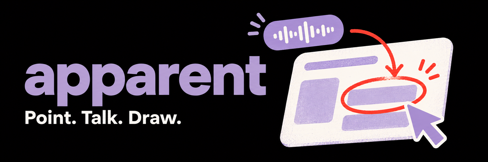

# Apparent

### Point. Talk. Draw. Let your agent take it from there.

That button. That weird layout. That bug that only happens when you do *this*.
Show your agent what you mean with a quick screen recording, your voice, and a few marks.

[Download Apparent](https://github.com/tryapparent/apparent/releases) · [Agent setup](capture/agent/docs/installation.md) · [Docs](#find-your-way) · [MIT](LICENSE)

## Show, then tell

1. **Record** — press `⌥⇧S` on macOS or `Alt+Shift+S` on Linux.
2. **Make your point** — talk, click around, hold `Shift` to draw, or `Shift`-click to drop a pin.
3. **Hand it off** — press the shortcut again to finish, then paste into your agent chat.

Your agent gets annotated keyframes, a timed transcript, and an interaction timeline
in a `.apparent` bundle. It can read what you said, see where you pointed, and pull
more frames when it needs a closer look.

Less “the thing next to the other thing.” More “oh, *that*.”

## Get started

**[Download a release for macOS or Linux](https://github.com/tryapparent/apparent/releases)**,
launch Apparent, and follow the permission setup. Linux main builds are previews;
choose the release for your platform. Windows is unsupported.

Prefer to let your agent handle installation? Paste this into its chat:

```markdown
Install the Apparent desktop app from [Apparent releases](https://github.com/tryapparent/apparent/releases), then launch it.
```

Need help getting set up? See the [recording guide](capture/desktop/docs/guides/recording.md)
and [Linux setup](capture/desktop/docs/linux/linux.md).

## Give your agent eyes

Install the optional capture-reading skill for Claude Code, Codex, OpenCode, and other agents:

```sh
bunx skills add https://github.com/tryapparent/apparent/tree/main/capture/agent/skills/apparent
```

The skill teaches your agent to read captures and look closer with `apparent zoom`,
`frames`, and `inspect`. [Install the CLI](capture/agent/docs/installation.md) on the
agent's machine too; installing the skill alone doesn't install the app.
Headless Linux agents can fetch and read captures without launching a desktop.

Want your agent to **show what it made**? The separate
[make-it-apparent skill](capture/agent/skills/make-it-apparent/SKILL.md) helps it make
and check a short video demo or explainer.

## Find your way

| I want to… | Start here |
| --- | --- |
| Record, draw, change shortcuts, or set up permissions | [Recording guide](capture/desktop/docs/guides/recording.md) |
| Set up a Linux desktop | [Linux guide](capture/desktop/docs/linux/linux.md) |
| Install the CLI on my agent's machine | [Agent installation](capture/agent/docs/installation.md) |
| Inspect, zoom, copy, or reprocess a capture | [CLI and agent guide](capture/agent/docs/usage.md) |
| Choose a transcriber, tune crops, or export video | [Processing guide](capture/engine/docs/guides/processing.md) |
| Fetch shared captures with Connect | [Connect setup](connect/docs/hosted-client.md) |
| Build and test Apparent | [Development reference](enablement/docs/development.md) · [macOS packaging](capture/desktop/docs/release.md) |
| Understand the bundle format | [Keyframes and text](capture/engine/docs/keyframes-and-text.md) |

**Connect is a candidate integration.** Uploads are off by default. Upload approval
and agent read approval are separate; website sign-in grants neither.
[Setup and current limits](connect/docs/hosted-client.md).

## License

[MIT](LICENSE). With thanks to the projects credited in our
[third-party notices](capture/desktop/docs/guides/credits.md).
